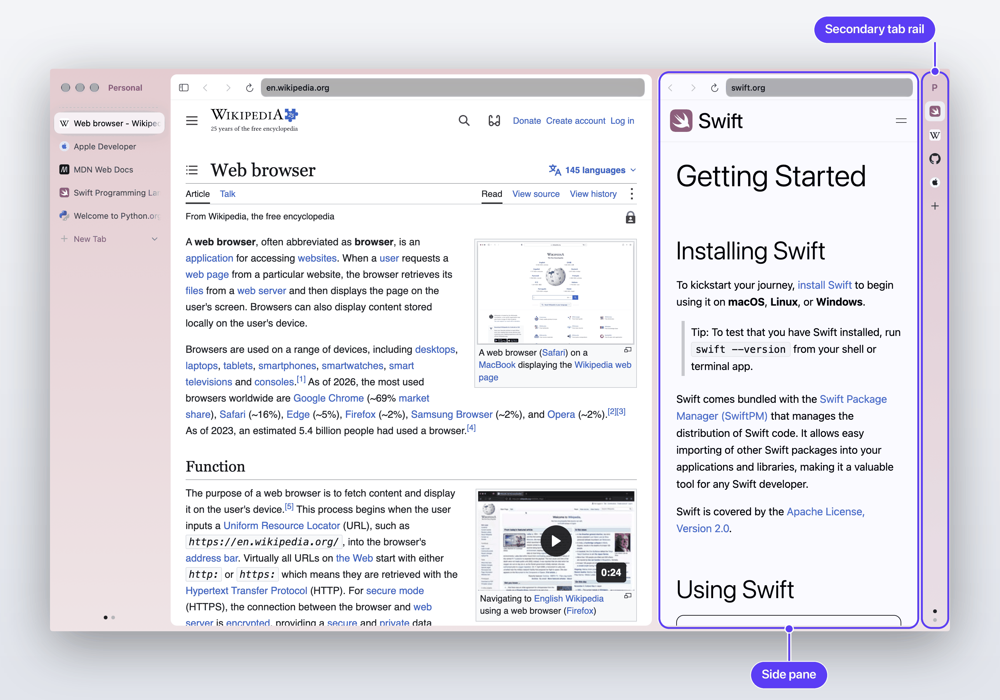
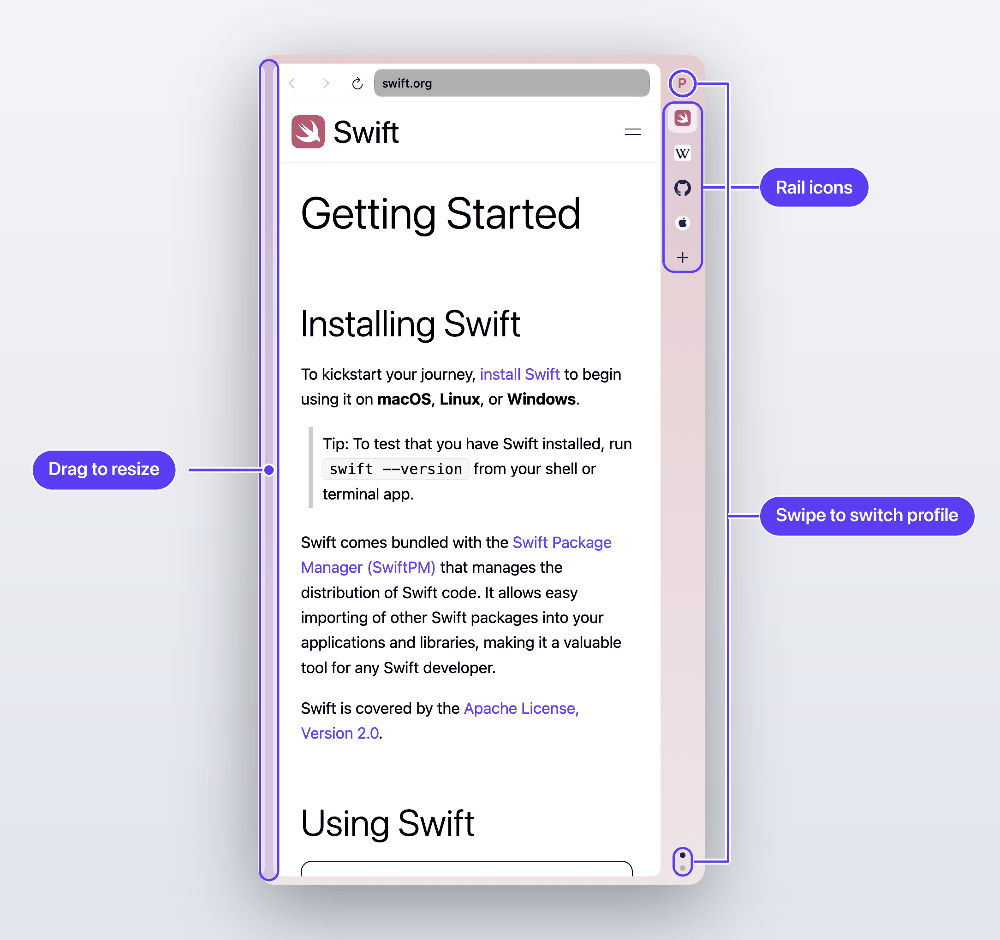
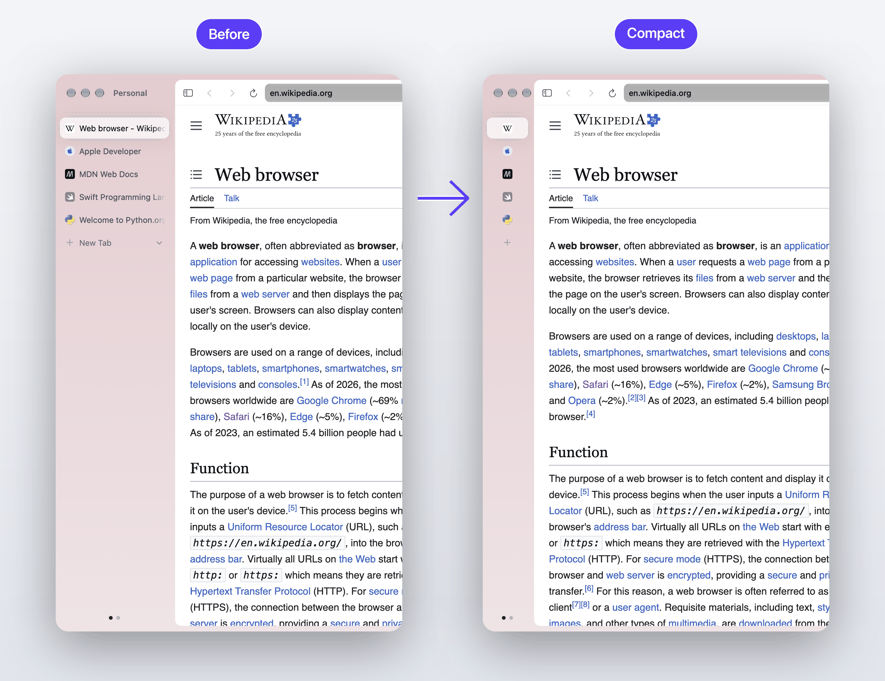
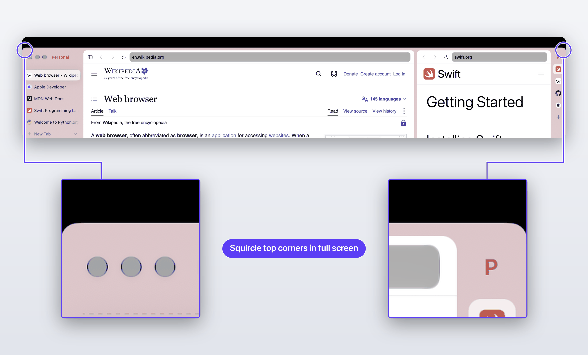
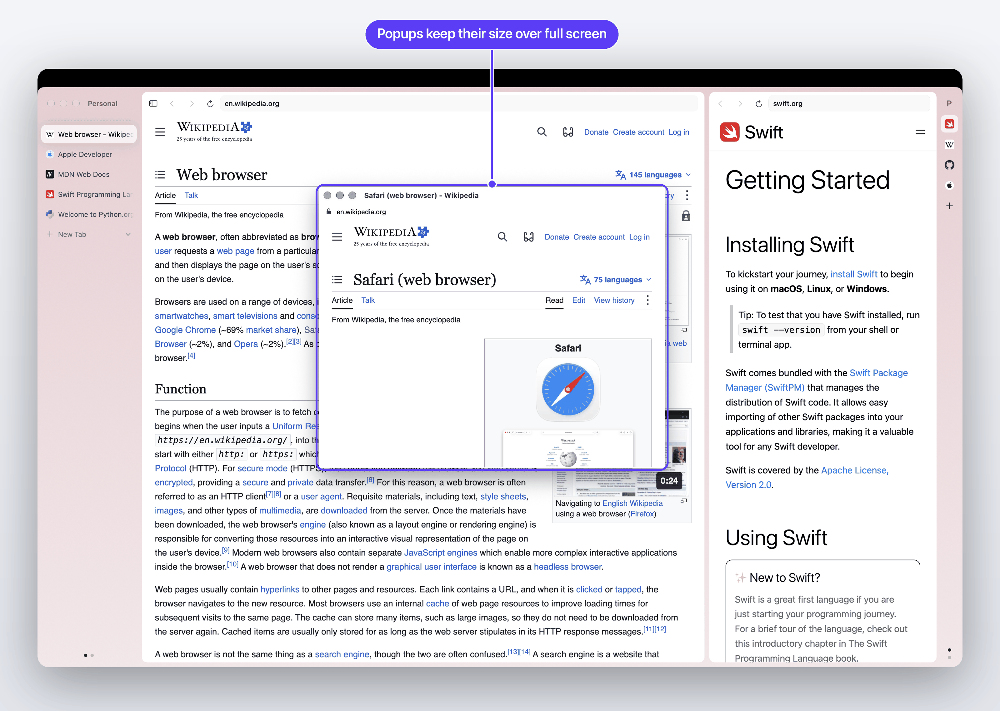

# Ardia, with a secondary tab rail

A community fork of [Ardia](https://github.com/mantrakp04/ardia) that keeps your always-open apps (ChatGPT, mail, chat) in a pane beside the page, one click away.

> **This is an unofficial fork.** It is based on Ardia **v0.2.43** and is not affiliated with, endorsed by or supported by the upstream maintainers. For the real thing, go to [github.com/mantrakp04/ardia](https://github.com/mantrakp04/ardia) or [ardia.dev](https://ardia.dev). Please don't report problems with this fork upstream.



The work lives on the branch `hanto/rail-0.2.43`, this fork's default branch.

## What's different

Everything else is stock Ardia 0.2.43.

### Secondary tab rail

A slim rail on the right edge of the window holds your "secondary tabs": the sites you keep open all day. Click an icon and that tab opens in a resizable pane next to the main page. Click it again to hide it. The pane stays put while you switch tabs on the left, so it works like a permanent split view.

- Rail tabs can come from any profile.
- The rail has its own profile, separate from the window's. Switch it with a two-finger swipe on the rail, the profile button, or the dots.
- Rail tabs are kept out of Memory Saver's reach (see [Known limitations](#known-limitations)).
- Works with both the sidebar and the top-tabs layout. Not available in private or small windows.



### Compact sidebar

Drag the left sidebar narrower than about 120 pt and it snaps to an 80 pt icon-only column. Titles show as tooltips, and the header tools, labels and close buttons are hidden.



### Rounded corners in full screen

In macOS full screen, the window gets rounded top corners, which suits MacBook displays with rounded corners. A page's own full screen (a video, say) keeps square corners.



### Popups over a full-screen window

A popup opened from a full-screen window (a "Sign in with Google" window, for example) joins that window's Space at normal size. Stock Ardia gives it a full-screen Space of its own, or leaves it behind.



## How to use

**Turn it on.** Settings › Tabs › Tab layout › **Secondary tab rail**. Turning it off hands the rail's tabs back to your normal tab list.

**Dock a tab.** Right-click a tab and choose **Move to › Secondary Tab Rail**. The rail's own context menu moves tabs back. The **+** on the rail opens a new rail tab.

**Show and hide.** Click a rail icon. Click it again to hide the pane.

**Resize.** Drag the divider between the page and the pane.

**Switch the rail's profile.** Swipe two fingers across the rail, click the profile button next to the traffic lights, or click a dot at the bottom of the rail.

**Compact sidebar.** Drag the left sidebar's edge below about 120 pt. Drag it wider again to go back.

## Build it yourself

There's no prebuilt app for this fork yet, so you build it. These steps follow upstream's `README.md` and `CONTRIBUTING.md` at v0.2.43. Check those first if something differs.

You need an Apple Silicon Mac on macOS 14 or later, Xcode 26+, CocoaPods, Node 22.13+ (see `.nvmrc`) and pnpm 11.

```bash
git clone https://github.com/LucidVacx/ardia.git
cd ardia
git checkout hanto/rail-0.2.43

pnpm install
packages/ardiacore/scripts/fetch-engine.sh   # prebuilt Chromium engine, about 110 MB, once
pnpm pods
```

The rail work doesn't touch `engine/`, so the engine that matches an upstream commit applies. `fetch-engine.sh` refuses to run if `engine/` has uncommitted changes. If it can't find a match, `--nearest` builds against the newest prebuilt one. The app's build also runs this step on its own when there's no local engine.

Then, in two terminals:

```bash
pnpm dev     # Metro, leave it running
pnpm macos   # builds the Debug app and opens it
```

`pnpm macos` uses its own data folder (`~/Library/Application Support/Ardia Dev`), so it won't touch an Ardia you already use. `pnpm build` makes a Release `.app` instead.

### Signing

Upstream's Xcode project is signed with Ardia's own Apple team. To build with yours, pass an xcconfig. This is a template with placeholder values only:

```
// MyTeam.xcconfig (keep this file out of git)
CODE_SIGN_STYLE = Automatic
DEVELOPMENT_TEAM = YOUR_TEAM_ID
CODE_SIGN_IDENTITY = Apple Development
```

Add `-xcconfig MyTeam.xcconfig` to the `xcodebuild` command in `apps/browser/package.json`, or set the team in Xcode's Signing & Capabilities tab. This template is a starting point and hasn't been tested on every setup.

Two things to know about a custom-signed build:

- **Passkeys/WebAuthn and some keychain features need Ardia's own signing team.** They won't work in a build signed by anyone else, upstream says the same.
- **Auto-update is turned off** in this fork's commit `Local only: Sparkle updater disabled`, so Sparkle can't replace your custom build with the upstream one. You update by pulling and rebuilding. That commit is local-only and not meant for upstream.

## Known limitations

- **Keep-awake is per site.** Rail tabs stay out of Memory Saver by adding their sites to its keep-active list. Other tabs on the same site stay active too. The engine has no per-tab exemption yet.
- **Reopened windows bring rail tabs back as normal sidebar tabs.**
- **Swiping over an overflowing rail list doesn't switch profile.** Use the profile button or the dots.
- **JS dialogs in the side pane are suppressed.** `alert()` and `confirm()` don't show, because Chromium treats the pane as a non-active tab.
- **No guard for a right-side sidebar yet.** v0.2.43 has no right-side sidebar position, so there's no clash today. Upstream 0.2.44 or later may need the rail to step aside for one.

## Contributing and upstreaming

The plan is to propose these changes to upstream as separate issues and pull requests, one feature at a time: the rail, the compact sidebar, the full-screen corners and the popup fix. Upstream decides what it takes. Its [CONTRIBUTING.md](https://github.com/mantrakp04/ardia/blob/main/CONTRIBUTING.md) says Ardia copies Dia's look on purpose and that restyling changes aren't welcome unless asked for, so the rail may be a hard sell there.

Issues and PRs on this fork are welcome. Bug reports, ideas, ports to newer upstream versions and screenshots for this README all help. Please keep PRs small and one feature each, so they're easy to carry upstream.

## Credits and license

This is built on [Ardia](https://github.com/mantrakp04/ardia) by Mantra Patel. All credit for the browser goes to the upstream project and its contributors. This fork adds only the changes listed above.

Following upstream (see `LICENSE`, `LICENSE.Apache-2.0` and `NOTICE`):

- Ardia **as distributed** is licensed under the **GNU General Public License v3**, because its engine is built with GPL-3.0 patches.
- Ardia's **own source files** are under the **Apache License 2.0**.
- It also builds on Chromium, carries a few Chromium Embedded Framework patches (BSD-3-Clause) and bundles uBlock Origin, each under its own license.

Changes in this fork are offered under the same terms. If you distribute a build, the GPL's source requirements apply.
